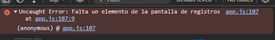
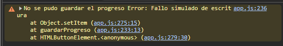
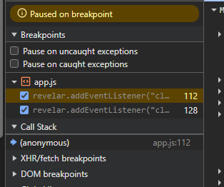
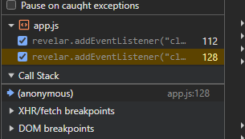

# Actividad 1:  

Use un Array para guardar los regisotros luego para los id únicos uso un set para quitar duplicados y para agrupar por zonas uso un Map, teniendo en cuenta que no se repitan y la fecha formateada usando Date y también DateTimeFormat.
  

# Actividad 2:  

Al pulsar el botón #revelar cambia el textContent y uso booleano para controlar que no se pueda dar a ver fichas mas de una vez y muestra el texto que se dijo en el enunciado.
  

# Actividad 3:  

Uso URLSearchParams para leer parametros de la URL para comprobar si existe.
   

# Actividad 4:  

El progreso se guarda en localStorge con clave "registros-ut3:v1:progreso" comprobando que no haya duplicados y exista la id, hay dos botones uno para simular un fallo que ará un texto de error y otro de ver ficha que abrira ficha.html en otra ventana.
   

# Actividad 5:  

Para esto hay que realizar los siguientes cambios(En app.js):
  
1. const revelar = document.querySelector("#revelarr");     
Error:  
  

2. En app.js cambiar en const VARIABLE-PROGRESO A escribir esto:  
const CLAVE_PROGRESO = "{mal json registros-ut3:v1:progreso";  
Podemos ver esta clave y cambiarla en el apartado de navegador Devtools "aplicación" e irse a localStorage

Dará el siguiente error:  
   

3.  Duplicar la funcion de revelar.addEventListener y hacemos breackpoints en cada 1 de las dos funciones duplicadas en el navegador en el apartado sources y veremos que saldrá cada una en callback:
Callback 1:   
  

Callback 2:  
  